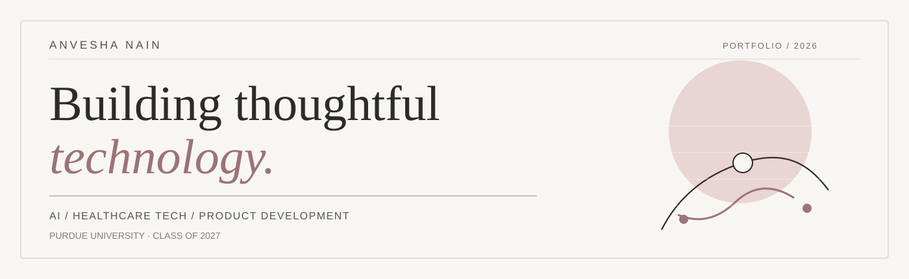

  

 

### Hello, I'm Anvesha.

I'm a Computer Science student at **Purdue University**, focusing on **Machine Intelligence** and graduating in **May 2027**. I like working at the intersection of AI, healthcare, and product development, especially when a technical idea can become something people actually use.

My background includes AI product work at **Ensora Health**, machine learning research, and building mobile and web applications. I'm currently interested in **AI robotics for mental health** and human-centered AI.

[**Explore my portfolio ↗**](https://anain0404.github.io/anvesha-portfolio/) &nbsp; · &nbsp; [**View my repositories ↗**](https://github.com/anain0404?tab=repositories)

---

### Selected work

| Project | What I worked on | Tools & focus |
| :--- | :--- | :--- |
| **SnapStudy** | An AI-powered study assistant that processes learning materials and supports accessible study workflows. | Flutter, FastAPI, Amazon Textract, Claude, Polly |
| **Protein Structure Research** | Deep learning research on protein structure analysis and more efficient computational workflows at Purdue's Kihara Lab. | Python, PyTorch, GPU computing |
| **Agentic AI Security Evaluation** | Red-teaming AI agents and evaluating how safeguards perform against adversarial attacks in a Prediction Guard collaboration. | LLM evaluation, AI security, red-teaming |
| **Spryn Health** | A health-focused mobile app project with personalized coaching concepts and a user-centered interface. | Flutter, Firebase, Figma |

*Some industry and research work cannot be shared as public source code. My [portfolio](https://anain0404.github.io/anvesha-portfolio/) has additional context about the projects and my contributions.*

---

### What I work with

**AI & data** &nbsp; `Python` `PyTorch` `LLMs` `RAG` `LangChain` `LlamaIndex` `Machine Learning`

**Development** &nbsp; `Java` `C/C++` `SQL` `Dart` `Flutter` `Firebase` `FastAPI` `Git`

**Product & design** &nbsp; `Figma` `Azure DevOps` `Product Discovery` `User Research` `PRDs` `Agile`

---

### Currently exploring

- **Human-centered AI:** how AI tools can support people in meaningful, responsible ways.
- **AI robotics for mental health:** interaction design, conversational systems, and safety-aware experiences.
- **AI product development:** turning user problems into tested, usable solutions.

---

### Beyond the code

I enjoy the product side of technology just as much as the technical side. Outside of projects, you'll usually find me around coffee, campus community events, or brainstorming the next thing to build.

**Let's connect:** [Portfolio](https://anain0404.github.io/anvesha-portfolio/) · [GitHub](https://github.com/anain0404)

Brewing ideas into products that make a difference. ☕
